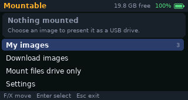
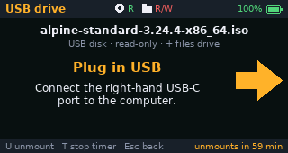
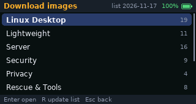

# Mountable

Turns a Cardputer Zero into a dynamic USB drive that can present any disk image.
You can add your own images to your SD card or download from the provided list of image
sources. It mounts your image as a USB drive or emulates a CD drive for older
equipment. If you need to transfer additional files, you can enable a "files" USB drive
that mounts alongside your image for your drivers, keys, apps, whatever really.

# Features

- Mount ISOs and raw disk images as a USB disk or CD-ROM, read-only or writable
- Download images from a built-in and growing catalog, verified by SHA-256
- Mounts and downloads keep running after you leave the app
- On-screen guidance when the Host/Slave switch is in the wrong position

## Screenshots

## Install

Each release has two packages on the
[releases page](https://github.com/s0liton/Mountable/releases):

- `mountable_<version>_arm64.deb` is the store build. Controlling the USB port
  needs administrator rights, so the app asks for the device password when it
  opens.
- `mountable-full_<version>_arm64.deb` is the root build. It installs the
  service to run all the time as root, so no password prompts.

To install a downloaded package on the device:

    sudo apt install ./mountable_<version>_arm64.deb

To remove it:

    sudo apt remove mountable

Removing the app leaves your images in `/srv/mountable`.

## Use

You will need to switch your Cardputer Zero into USB device mode. If you look at the USB-A port
on the left side of the device, there is a tiny little switch above the port. 
Flip it towards the top of the device. This is REQUIRED.

Place your own images in `/srv/mountable/images` or just download them from the provided catalog.

## License

Mountable is free software under the GNU General Public License, version 3.
See [LICENSE](LICENSE).
